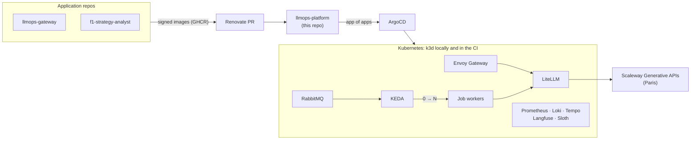
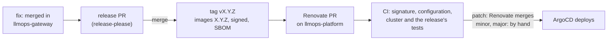
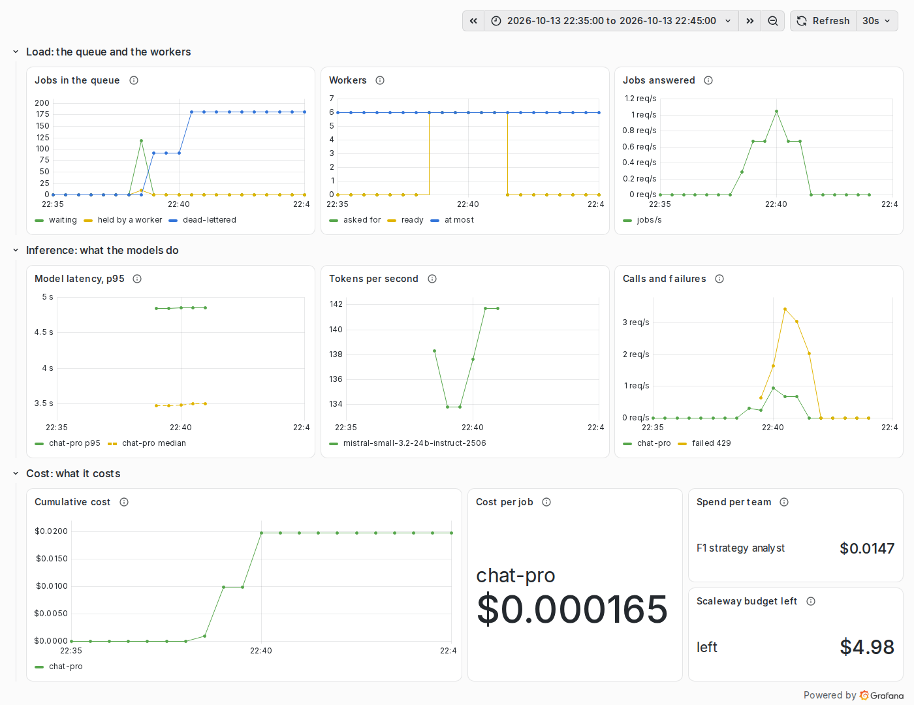
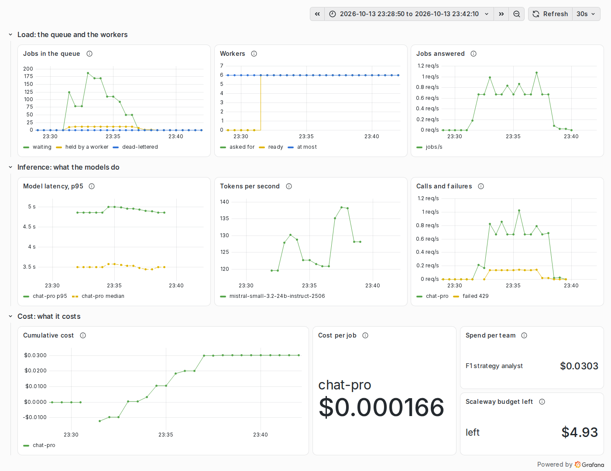

# llmops-platform

[](https://github.com/Mak5ens/llmops-platform/actions/workflows/ci.yml)
[](LICENSE)

**A production-grade Kubernetes platform for LLM workloads: deployed from Git, observed from the request to the log line, with job workers that scale from zero and a measured cost per team.**

> Status: under construction. Milestone 2 (local cluster, GitOps, observability, SLOs, supply chain and article 2) is done; milestone 3 (job queue, autoscaling and inference on Scaleway) is under way. See the [roadmap](#roadmap).

## Why

The [gateway](https://github.com/Mak5ens/llmops-gateway) runs, tenant teams are arriving, and hand-managed model servers no longer hold.
The Platform team builds a **production Kubernetes platform**: deployed from Git, observed, secured, with long jobs on a queue and models served by Scaleway in Paris, at a measured cost per team.

This repo holds the **infrastructure and the GitOps configuration of every environment**. Application repos publish signed images; this repo describes what runs where. Renovate proposes version bumps as PRs and ArgoCD deploys after merge.

## How it works



Request path: team app → Envoy Gateway → LiteLLM (team key, anonymization, routing) → the model → re-identified answer. Long jobs go through RabbitMQ instead, and workers call the gateway the same way. The models are small Ollama servers on the cluster today, and Scaleway Generative APIs from milestone 3.2: personal data is masked before it leaves the cluster. Every step is traced (Langfuse, OpenTelemetry) and counted (tokens and cost per team).

## Stack

| Function | Tool |
| -- | -- |
| Cluster | k3d (k3s in Docker) locally and in the CI; the bootstrap runs on any Kubernetes 1.37 |
| GitOps | ArgoCD, app of apps, Helm or Kustomize |
| HTTP exposure | Gateway API with Envoy Gateway, cert-manager |
| Database and secrets | CloudNativePG, External Secrets Operator |
| Metrics, logs, traces | kube-prometheus-stack, Loki, Tempo, OpenTelemetry Collector |
| SLO | Sloth |
| Jobs and autoscaling | RabbitMQ (operators), KEDA (scale 0 → N on queue length) |
| Inference and cost | Ollama on the cluster, then Scaleway Generative APIs; cost per team and per job from LiteLLM |
| Load tests | k6 |
| Supply chain | GitHub Actions, Trivy, Syft (SBOM), cosign, Renovate |

## Quick start

`just up` creates the local cluster and installs ArgoCD, which deploys the rest from Git: ArgoCD itself, HTTP exposure (Envoy Gateway, cert-manager), secrets (External Secrets), PostgreSQL (CloudNativePG), the gateway of block 1 with Presidio, Ollama and Langfuse, observability (Prometheus, Grafana, Loki, Tempo, OpenTelemetry Collector) and the job queue (RabbitMQ).
On a GitHub runner (4 cores, 16 GB), the cluster is created in 26 s, and every component is synced and healthy 11 minutes later; `just test` then takes about 4 minutes.

Requirements: [Docker](https://docs.docker.com/engine/install/), [k3d](https://k3d.io/) v5.9.0, [kubectl](https://kubernetes.io/docs/tasks/tools/), [Helm](https://helm.sh/) v4 and [just](https://just.systems/).
The empty cluster takes about 1 GB of RAM, the platform as it stands about 13 to 14 GB, of which 3 GB for Presidio and LiteLLM, 2 GB for Langfuse and about 1.5 GB for observability; the target for the whole platform is a machine like a GitHub runner, 4 cores and 16 GB.

```bash
just up               # k3d cluster, then ArgoCD deploys every component from Git
just test             # cluster, Applications, self-heal, HTTPS, PostgreSQL failover and restore, job queue, latency → trace → logs, SLO alert
just ca-cert          # exports the local CA to local/ca.pem
just test-gateway     # the integration tests of block 1 against the cluster (needs ../llmops-gateway)
just argocd-password  # ArgoCD admin password; the UI is on https://argocd.localtest.me
just down             # deletes the cluster, its registry and its kube context
```

ArgoCD deploys what is on GitHub, not what is on your disk: it follows `main` by default. To try a branch, push it and run `REVISION=my-branch just up`.

### The local cluster

The cluster is described in [`local/k3d.yaml`](local/k3d.yaml):

- Kubernetes 1.37; Traefik disabled, since exposure goes through Envoy Gateway ([ADR-005](docs/adr/005-gateway-api-and-envoy-gateway.md));
- ports 80 and 443 of `localhost` go to the cluster's load balancer;
- a local registry for images built on the machine: push to `localhost:5050/<image>`, reference `registry.localhost:5050/<image>` in manifests. The platform itself pulls its images from GHCR;
- the `k3d-llmops` context is added to `~/.kube/config` without becoming the current one (unless there was none). Recipes always pass it explicitly.

`just cluster-up`, `just cluster-check` and `just cluster-down` handle the cluster alone.

### GitOps with ArgoCD

`just bootstrap` installs ArgoCD once and hands it the root Application ([ADR-008](docs/adr/008-argocd.md)). From then on, nothing is installed by hand:

- [`platform/<component>/`](platform/) holds each component as Kustomize, with a `base` and an overlay per environment: `local` today, for k3d, minikube or a k3s server;
- [`apps/`](apps/) is the app of apps, a small Helm chart: one ArgoCD Application per component of [`apps/values.yaml`](apps/values.yaml), pointing to `platform/<component>/overlays/<env>`. Sync waves order them, operators and CRDs first;
- the root Application renders this chart with the environment and the Git revision, including itself, so both are set once by the bootstrap;
- ArgoCD manages its own installation from [`platform/argocd/`](platform/argocd/), like any other component;
- every Application syncs automatically, prunes what was removed from Git, and repairs manual changes (self-heal).

ArgoCD compares with a server-side dry run (`controller.diff.server.side`), so the defaults the API server adds to Gateway API resources are not reported as drift.
Locally, ArgoCD polls GitHub every minute: a pushed change reaches the cluster within about a minute and a half.
The CI does the same on every PR: it creates the cluster, bootstraps ArgoCD from the branch under test and runs `just test`.

### HTTP exposure

Services are exposed through the Gateway API ([ADR-005](docs/adr/005-gateway-api-and-envoy-gateway.md)), never with an `Ingress`, which a pre-commit hook rejects:

- [`platform/envoy-gateway/`](platform/envoy-gateway/) installs Envoy Gateway and the Gateway API CRDs; [`platform/cert-manager/`](platform/cert-manager/) installs cert-manager;
- [`platform/gateway/`](platform/gateway/) holds the shared `Gateway` of the cluster, in the `gateway` namespace. Its HTTPS listener serves `*.localtest.me`, whose subdomains all resolve to 127.0.0.1; plain HTTP redirects to HTTPS;
- each service brings its own `HTTPRoute`. Only namespaces labelled `llmops-platform/gateway-access: "true"` can attach one, so a tenant cannot take over another host name;
- locally, certificates come from a certificate authority created by cert-manager in the cluster. `just ca-cert` exports it, to pass to curl (`--cacert local/ca.pem`) or to import in a browser. The CA is new with every cluster.

### Databases and secrets

- [`platform/cloudnative-pg/`](platform/cloudnative-pg/) installs the CloudNativePG operator and its Barman Cloud plugin ([ADR-018](docs/adr/018-postgresql-cloudnativepg.md)). Each application that needs PostgreSQL declares its own `Cluster` in its component: `litellm-db` in [`platform/llm-gateway/`](platform/llm-gateway/), `langfuse-db` in [`platform/langfuse/`](platform/langfuse/);
- each cluster runs a primary and a synchronous replica on different nodes. If the primary fails, the replica takes over without losing a commit: 15 s measured locally;
- WAL is archived continuously to S3, with a base backup every night and one at creation, kept 7 days: any point in time of the last week can be restored ([runbook](docs/runbooks/postgres-restore.md)). The S3 store is SeaweedFS, in the cluster ([`platform/object-storage/`](platform/object-storage/));
- [`platform/external-secrets/`](platform/external-secrets/) installs External Secrets Operator ([ADR-019](docs/adr/019-external-secrets.md)). Every `ExternalSecret` reads the `ClusterSecretStore` named `platform` ([`platform/secret-store/`](platform/secret-store/)): random values that `just bootstrap` writes once into the `local-secrets` namespace; with a real secret manager, only the store would change. No secret value is ever in Git, and gitleaks checks the whole history in the CI;
- applications connect to their database with the `<cluster>-app` Secret that CloudNativePG creates.

`just test` deletes the primary of `litellm-db` and checks that the last commit survives, then restores a fresh backup into a new cluster from S3 alone.

### The gateway of block 1

The gateway of [`llmops-gateway`](https://github.com/Mak5ens/llmops-gateway) runs on the cluster with the same behavior as in its Docker Compose stack, which stays the quickest demo without Kubernetes:

- [`platform/llm-gateway/`](platform/llm-gateway/): LiteLLM from its official Helm chart, on `https://llm.localtest.me`, with its Redis, which counts the spend of `chat-pro` against its monthly cap; Presidio Analyzer and Anonymizer; two small Ollama servers until the models move to Scaleway (milestone 3.2); and the `tenants-bootstrap` Job, which ArgoCD runs after every sync to create the client teams, their keys and their Langfuse projects;
- the cluster serves `chat-large` and `chat-medium` with `qwen2.5:0.5b` under the names `config/litellm.yaml` gives them, to fit the 16 GB CI runner. The tests only check that `chat-large` answers and falls back; `chat-medium` answers, but no model under 3 B passes its JSON test, so the platform lists it in `STAND_IN_ALIASES` and the gateway's tests skip that one. `chat-pro` calls Scaleway Generative APIs with the key of the store's `scaleway` secret, read from the `.env` of llmops-gateway by `just bootstrap`; the CI has none, and skips its tests;
- [`platform/langfuse/`](platform/langfuse/): Langfuse from its official chart, on `https://langfuse.localtest.me`, with its database on CloudNativePG, its events and media on SeaweedFS, and a single-node ClickHouse (the chart's needs the ClickHouse operator);
- the images of our own come from llmops-gateway on GHCR: the French Presidio Analyzer, and LiteLLM with the guardrail class and the bootstrap scripts. `config/litellm.yaml` and `config/tenants.yaml` are copies of llmops-gateway's: the services have the same names as in Compose, so the files are identical. A release of the gateway reaches the cluster through a Renovate PR (see below);
- every secret (master key, team keys, Langfuse keys and accounts) is written once to `local-secrets` by `just bootstrap`; `just gateway-secrets` prints the ones you need to call the gateway or sign in to Langfuse;
- Prometheus scrapes LiteLLM's own metrics, and `ScalewayBudgetLow` fires when less than $1 is left of the 30-day cap ([runbook](docs/runbooks/scaleway-budget.md)).

The integration tests of block 1 run unchanged against the cluster, in the CI after `just test` and locally with `just test-gateway`: about 10 minutes, most of it waiting for ArgoCD to put things back after the fallback and leak tests.

Two things the move taught:

- Envoy cuts a request after 15 s by default. A `chat-large` call that falls back to `chat-small` takes up to 20 s, so the route to LiteLLM has a 90 s timeout.
- Kustomize's namespace transformer leaves the resources rendered from a Helm chart alone. Without a namespace, the LiteLLM Deployment kept the name of its ConfigMap without the content hash, and would not restart on a configuration change. A patch sets the namespace.

### From a commit of the gateway to the cluster

A new version of the gateway reaches the cluster through a PR, without copying a tag by hand ([ADR-023](docs/adr/023-image-propagation.md)):



1. release-please keeps a release PR open in llmops-gateway, with the next version and the changelog, from the merged Conventional Commits.
2. Merging it tags `vX.Y.Z` and publishes both images as `X.Y.Z`, signed by `build-image.yml` with their SBOM (ADR-022).
3. At its next run, within the hour, Renovate opens one PR here for both images.
4. The `gateway-release` job checks the images' signatures and SBOMs (`just verify-images`) and that `platform/llm-gateway/base/config/` matches the release. When a release changes `config/litellm.yaml` or `config/tenants.yaml`, the job fails with the diff: `just gateway-config` on the PR's branch copies the release's files, in one commit.
5. The `cluster` job deploys the PR's branch and runs the gateway's integration tests from the release's tag.
6. Renovate merges a patch once every check has passed. A minor is merged by hand, and a major also waits for an approval on the dependency dashboard.
7. ArgoCD deploys `main`: the *llm-gateway* Application shows the new image tag.

### Observability

Metrics, logs and traces lead to one another ([ADR-020](docs/adr/020-observability-stack.md)). Grafana is on `https://grafana.localtest.me` (`just grafana-password`):

- [`platform/monitoring/`](platform/monitoring/): kube-prometheus-stack (Prometheus, Alertmanager, Grafana, node-exporter, kube-state-metrics), the `Gateway` dashboard and the alert rules, in Git. Every `ServiceMonitor`, `PodMonitor` and `PrometheusRule` of the cluster is picked up;
- [`platform/loki/`](platform/loki/) and [`platform/tempo/`](platform/tempo/): one process each, 48 h of logs and 24 h of traces. Tempo's metrics generator turns spans into rate and latency metrics, with the trace ID of sampled requests (exemplars);
- [`platform/otel-collector/`](platform/otel-collector/): one OpenTelemetry Collector per node, the single entry point of telemetry. It reads the pod logs of its node, receives OTLP from applications, adds the Kubernetes attributes, and sends logs to Loki, traces to Tempo and metrics to Prometheus;
- Envoy traces every request through the Gateway and sends its access logs over OTLP, with the trace ID.

On the `Gateway` dashboard, a dot on the latency graph is an exemplar: a click opens the request's trace in Tempo, and *Logs for this span* opens its access log in Loki. `scripts/observability-check.sh` follows these two clicks through the APIs on every run of `just test`.
The control plane is not scraped: it is embedded in k3s, and out of reach on a managed cluster. The rules that would fire for its missing targets are off.

### SLOs and runbooks

The gateway has two SLOs, measured by Envoy on the route to LiteLLM ([ADR-021](docs/adr/021-gateway-slos.md), [`slo/gateway.yaml`](slo/gateway.yaml)):

| SLO | Objective, 30 days | Alert |
| -- | -- | -- |
| Availability | 99.5 % of requests without a 5xx (4xx are the gateway doing its job) | `GatewayAvailabilityBudgetBurn` → [runbook](docs/runbooks/gateway-5xx.md) |
| Latency | 95 % of requests answered in under 30 s (total duration; time to first token once streaming is measured, milestone 3.2) | `GatewayLatencyBudgetBurn` → [runbook](docs/runbooks/gateway-latency.md) |

Sloth's CLI generates the recording rules and the multi-window burn rate alerts: `just slo` after a change to `slo/`, checked by a pre-commit hook. A page fires when the budget burns 14.4 times too fast over 5 minutes and 1 hour. `scripts/slo-check.sh` stops the server of `chat-small` and checks that it fires, with its runbook: 169 s locally.
A model server that restarts in a loop has its own alert, `ModelServerCrashLooping` → [runbook](docs/runbooks/model-server-crashloop.md).

Grafana holds the error budget (*SLO / Detail*, *High level Sloth SLOs*) next to the `Gateway` dashboard, and the community dashboards of CloudNativePG and Envoy Gateway at a pinned revision (`scripts/fetch-dashboards.py`).

### The job queue

Long jobs (analysing a Formula 1 season, checking a batch of documents) go through a queue rather than synchronous calls ([ADR-004](docs/adr/004-rabbitmq.md)):

- [`platform/rabbitmq-operator/`](platform/rabbitmq-operator/) installs RabbitMQ's Cluster Operator and Messaging Topology Operator;
- [`platform/job-queue/`](platform/job-queue/) declares a one-node RabbitMQ 4.3 cluster in the `jobs` namespace, its default user from the store `platform`, and its exchanges, queues, bindings and policy as Kubernetes resources: a new cluster gets the same topology from Git;
- a job is published to the exchange `jobs` with the routing key `inference` and lands in the quorum queue `jobs.inference`;
- RabbitMQ handles failures by configuration, without code of ours (policy `jobs-retry`): a job that a worker rejects, or that dies with its worker, comes back after 5 s times its number of failures, and after its third failure it is set aside in `jobs.inference.dead`;
- the *Job queues* dashboard shows what waits, what runs, what was retried and what failed, next to the *RabbitMQ-Overview* dashboard of the node. A job in a dead letter queue fires `JobsDeadLettered` → [runbook](docs/runbooks/jobs-dead-lettered.md), which replays the jobs with a shovel once the cause is fixed.

`scripts/queue-check.sh`, run by `just test`, fails a job three times as a worker would: the retries come 5 s, then 10 s after the failures, and the job ends in the dead letter queue, where Prometheus sees it.

### Workers scaled from zero

The workers come from llmops-gateway ([`worker/`](https://github.com/Mak5ens/llmops-gateway/tree/main/worker)): they run each job through the gateway with the key of the job's team, reply to its `reply_to`, and give failed jobs back to RabbitMQ. On SIGTERM, a worker finishes the jobs it holds before it exits.

- [`platform/keda/`](platform/keda/) installs KEDA;
- [`platform/job-worker/`](platform/job-worker/) deploys the worker, with the teams' keys from the store `platform`, and its `ScaledObject`, which KEDA turns into replicas.

| Setting | Value | Why |
| -- | -- | -- |
| Metric | jobs in `jobs.inference`, waiting or held by a worker | through the management API: counting only the waiting jobs (AMQP) would scale workers down while they still work |
| Jobs per worker | 2 | each worker runs 2 jobs at a time (`WORKER_CONCURRENCY`): no job waits once the workers have caught up |
| Workers | 0 to 6 | zero while the queue is empty; 6 fit in the CI runner's 16 GB with the rest of the platform |
| Polling | every 5 s | on top of the 5 to 12 s RabbitMQ's statistics take to count a new job: the first worker is asked for about 10 s after the first job |
| Fewer workers | 2 min after fewer jobs | the HPA's default of 5 min kept 6 workers for a load that needed 3; 30 s made them flap |
| Back to zero | 60 s after the queue empties | a burst within the minute finds its workers; 30 s cost it a cold start |
| Grace period | 150 s | longer than a call to the gateway (120 s), so a scale-down never cuts a job |

`scripts/autoscaling-check.sh`, run by `just test`, publishes 500 simulated jobs of 2 s and deletes a worker halfway. Locally, the first worker is ready 13 s after the first job, 6 workers answer the 500 jobs in 112 s, each exactly once and none dead-lettered, and the workers are back to zero 65 s later.

The values above come from load tests: three k6 scenarios (a ramp, two bursts, a steady load) against five settings, in [`benchmarks/`](benchmarks/README.md), replayed with `just bench-autoscaling`. The first job of a burst is answered 12 to 21 s after its publication whatever the setting, mostly the time RabbitMQ's statistics take to show it to KEDA; the HPA then takes two of its 15 s cycles to reach 6 workers.

### Inference and unit cost

The *Inference* dashboard puts block 2 on one time axis ([`inference.json`](platform/monitoring/base/dashboards/inference.json)): the load (jobs in the queue, set aside, answered; workers asked for and ready), what the models do (latency per alias, tokens per second, calls and failures by HTTP status) and what it costs (per alias, per team, per job, and what is left of the Scaleway cap). Everything comes from LiteLLM's own Prometheus metrics, RabbitMQ's and kube-state-metrics': no tracing pipeline in between.

- **Cost per job**: the worker calls the gateway as end user `llmops-worker` (llmops-gateway 0.5.0), so its calls stand apart from the team's own, with the same key. Their spend divided by their calls, one per job answered, is the recording rule `alias:job_cost_dollars:avg1h`, and a panel over the dashboard's time range. Simulated jobs make no call and cost nothing.
- **Alerts**, each with its runbook: `JobsBacklogAtMaxWorkers` when the queue grows for 10 minutes with every worker busy, `ScalewayErrors` when more than 5 % of the calls to Scaleway fail, next to `JobsDeadLettered` and `ScalewayBudgetLow`.
- `scripts/inference-peak.sh` sends a peak of real jobs (the `spike` scenario of `benchmarks/k6/`, on `chat-pro` by default), and `scripts/scaleway-bill.py` compares what LiteLLM counted with Scaleway's bill over the same time (billing API, a key with `BillingReadOnly`).



*302 jobs on `chat-pro`, in two bursts of 150, on 2026-10-13.* The six workers came, and the gateway answered 429 to most of their calls: the `f1` team's key allows 60 requests a minute (`config/tenants.yaml`), and twelve jobs at a time ask for more. The worker retried them 5 s and 10 s later, inside the same minute, and 182 jobs went to the dead letter queue after their third failure (`JobsDeadLettered` fired). The 120 jobs answered cost $0.0197 in all, $0.000164 each. The worker now waits for the rate limit to reset instead (llmops-gateway 0.5.1, LAB-194):



*The same 302 jobs with the worker of 0.5.1.* On a 429, a worker holds its job until the limit resets (the `reset_at` LiteLLM sends, 60 s at most), then gives it back with `basic.nack`, which RabbitMQ does not count as an attempt. The gateway still answers some 429s, but every job is answered and none is dead-lettered: the workers slow down to the team's limit, about 45 jobs a minute. The peak takes 7 minutes instead of 2, a job waits 159 s at the median, and costs the same, $0.000166.

**The bill agrees.** Over the same peak, LiteLLM counted 55,030 tokens out and 3,144 in for `chat-pro`, $0.0197 at Scaleway's price; Scaleway's billing API showed 56,000 and 4,000, €0.02, 35 minutes after the peak (`scripts/scaleway-bill.py`). Scaleway bills per thousand tokens and rounds each line to the cent: −1.7 % on the output tokens and −1.3 % on the cost are within that rounding, and so are the 856 input tokens of difference. The gateway's count is the one to trust per job; the bill confirms it per batch.

### On minikube or a k3s server

k3d only creates the cluster ([ADR-017](docs/adr/017-local-cluster-k3d.md)): the bootstrap runs on any cluster, given its kube context.

- **minikube** (checked on 2026-10-07 with minikube v1.39.0, a single node): `minikube start --kubernetes-version=v1.37.1 --cpus=8 --memory=16g`, then `minikube tunnel` in another terminal so that LoadBalancer Services get an address; without it, the Gateway stays `AddressNotAssigned` and never becomes healthy. `minikube start` makes `minikube` the current kube context.
- **k3s server**: before installing, disable Traefik in `/etc/rancher/k3s/config.yaml` (`disable: [traefik]`) and skip the Gateway API CRDs that k3s bundles, which conflict with Envoy Gateway's: `touch /var/lib/rancher/k3s/server/manifests/gateway-api-crd.yaml.skip`. Then copy `/etc/rancher/k3s/k3s.yaml` into your kubeconfig.

On both, `*.localtest.me` resolves to 127.0.0.1: point the host names to the address of the Envoy Service instead, in `/etc/hosts` or with `curl --resolve`.
On minikube, the tunnel asks for sudo to bind ports 80 and 443 on 127.0.0.1. Without it, use the NodePort of Envoy's HTTPS listener on the node's address:

```bash
port=$(kubectl --context minikube -n envoy-gateway-system get svc \
  -o jsonpath='{.items[?(@.spec.type=="LoadBalancer")].spec.ports[?(@.port==443)].nodePort}')
curl --cacert local/ca.pem --resolve "llm.localtest.me:$port:$(minikube ip)" "https://llm.localtest.me:$port/health/liveliness"
```

There, every Application is synced and healthy, the PostgreSQL failover takes 20 s as on k3d, and ArgoCD, LiteLLM and Langfuse answer over HTTPS with the local CA's certificate.

Then bootstrap it: `just bootstrap <kube context>` (for example `just bootstrap minikube`).

To contribute, install the git hooks (requires [pre-commit](https://pre-commit.com/)):

```bash
just hooks
just lint
```

## Roadmap

### Milestone 2: Kubernetes in GitOps

- [x] **2.1 Local cluster and GitOps**: k3d, ArgoCD app of apps, Envoy Gateway, cert-manager, CloudNativePG, External Secrets. The block 1 gateway deployed from Git.
- [x] **2.2 Observability, SLO and supply chain**: Prometheus, Loki, Tempo, OpenTelemetry. Two Sloth SLOs with alerts and runbooks. Trivy, Syft, cosign in CI; Renovate, and releases of the gateway deployed through its PRs.
- [x] **2.3 ArgoCD decision and article 2**: [ADR-008](docs/adr/008-argocd.md) and [article 2](https://maxence-labbe.fr/en/articles/kubernetes-platform-gitops/). The cloud cluster on Scaleway Kapsule was dropped on 2026-10-11: it would show nothing the k3d cluster and its CI do not already show ([ADR-002](docs/adr/002-scaleway.md), update).

### Milestone 3: jobs, autoscaling and inference

- [x] **3.1 Workers and KEDA autoscaling**: RabbitMQ with retries and a dead letter queue, simulated workers, KEDA from 0 to N. k6 load profiles and measured scale-up times, which set KEDA's values ([`benchmarks/`](benchmarks/README.md)).
- [ ] **3.2 Inference and unit cost**: commercial models on Scaleway Generative APIs, local ones on Ollama ([ADR-027](docs/adr/027-scaleway-generative-apis.md)); time to first token, tokens per second and cost per call and per job, measured ([`benchmarks/inference/`](benchmarks/inference/README.md)). Next, one dashboard with queue, replicas, latency and cumulative cost on the same time axis.
- [ ] **3.3 F1 season benchmark**: analyse every session of a Formula 1 season as jobs, cost per session compared with a commercial API. Article 3.

## Architecture decisions

This repo hosts the **cross-cutting ADRs** for the whole platform in [`docs/adr/`](docs/adr/): GitHub Actions, Scaleway, Terraform (on hold), RabbitMQ, Envoy Gateway, self-hosted Langfuse, ArgoCD, the multi-repo layout, k3d for the local cluster, CloudNativePG, External Secrets, the observability stack, the gateway's SLOs, the supply chain and the propagation of images between repos. Repo-specific ADRs stay in their own repo.

## Part of an internal AI platform

| Repo | Role |
| -- | -- |
| [llmops-gateway](https://github.com/Mak5ens/llmops-gateway) | Block 1: single entry point to LLMs, keys, budgets, anonymization, tracing |
| **llmops-platform** (this repo) | Block 2: Kubernetes in GitOps, job queue and autoscaling, observability, costs |
| [f1-strategy-analyst](https://github.com/Mak5ens/f1-strategy-analyst) | Block 3: first tenant, an agent with RAG and an evaluation CI |

Write-ups on [maxence-labbe.fr](https://maxence-labbe.fr): article 2, [*A Kubernetes platform from scratch in GitOps*](https://maxence-labbe.fr/en/articles/kubernetes-platform-gitops/) ([in French](https://maxence-labbe.fr/articles/plateforme-kubernetes-gitops/)). Article 3, on autoscaling and the cost of a Formula 1 season, comes with milestone 3.

## License

[MIT](LICENSE).
