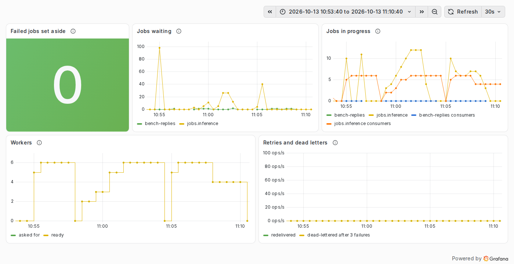

# Autoscaling benchmarks

How fast do the job workers follow the load, and what does it cost? Three [k6](https://k6.io) load scenarios, five KEDA settings, on the local k3d cluster (LAB-136). The setting chosen from these numbers is the one in [`platform/job-worker/base/autoscaling.yaml`](../platform/job-worker/base/autoscaling.yaml).

```bash
just bench-autoscaling spike              # every setting, about 5 min each
just bench-autoscaling ramp git tuned     # some settings only
```

The recipe runs [`scripts/bench-autoscaling.sh`](../scripts/bench-autoscaling.sh), then [`scripts/bench-report.py`](../scripts/bench-report.py) writes the table and the chart of the scenario in [`results/`](results/). Run it on a test cluster: it suspends ArgoCD's reconciliation of `job-worker` while it changes the `ScaledObject`, and puts it back at the end.

## Method

- **The jobs** are simulated: each one waits about 2 s (±25 %) in the worker instead of calling a model ([worker README](https://github.com/Mak5ens/llmops-gateway/tree/main/worker#a-job)). The workers' own cost is what is measured, not a model's.
- **k6 runs inside the cluster** as a Job ([`k6/job.yaml`](k6/job.yaml)), next to RabbitMQ. It publishes the jobs through RabbitMQ's management API, with a reply queue, and reads the replies every 0.5 s: a job's latency runs from its publication to its reply, so it includes the wait for a worker, the cold start of the first one, and the 2 s of work.
- **The script records every second** the workers asked for and ready (`kubectl`), and the jobs in `jobs.inference`, waiting or held by a worker (management API). It stops once the workers are back to zero.
- **Before each run**, the workers are at zero, and the HPA that KEDA manages is deleted, then recreated by KEDA: an HPA remembers the replica counts of its last minutes (see below), and would otherwise start a run at the previous run's peak.

The scenarios ([`k6/autoscaling.js`](k6/autoscaling.js)):

| Scenario | Load | What it shows |
| -- | -- | -- |
| `ramp` | from 0 to 6 jobs/s over 3 min, held 1 min, back to 0 over 1 min | scale-up as the load grows, scale-down as it falls; 6 jobs/s is exactly what 6 workers of 2 jobs at a time can answer |
| `spike` | 150 jobs in 5 s, then 150 again 95 s later | the cold start, and whether the workers are still there for the second burst |
| `soak` | 3 jobs/s for 4 min, then nothing | a steady load that needs 3 workers |

The settings, all with 0 to 6 workers and KEDA polling every 5 s:

| Setting | Jobs per worker | Zero workers after | HPA scale-down window |
| -- | -- | -- | -- |
| `eager` | 2 | 30 s | 300 s |
| `git` | 4 | 60 s | 300 s |
| `frugal` | 8 | 120 s | 300 s |
| `git-down30` | 4 | 60 s | 30 s |
| `tuned` | 2 | 60 s | 120 s |

- **Jobs per worker** is KEDA's target: workers = jobs in the queue (waiting or running) / target. A worker runs 2 jobs at a time, so with 2 no job should wait, and with 8 each worker has 6 waiting.
- **Zero workers after** is KEDA's `cooldownPeriod`: the time without any job before the last worker stops.
- **The scale-down window** is the HPA's: it scales down to the highest count it computed over that window. Kubernetes' default is 300 s. KEDA only handles 0 ↔ 1; between 1 and 6, the HPA decides.

`git` was the setting of LAB-135; `tuned` came out of the first four.

## Results

The full tables, with the chart of each scenario: [`spike`](results/spike.md), [`ramp`](results/ramp.md), [`soak`](results/soak.md). Below, the measures that decided.

| | `eager` | `git` | `frugal` | `git-down30` | `tuned` |
| -- | -- | -- | -- | -- | -- |
| first job answered after (spike, soak) | 15 s, 15 s | 21 s, 13 s | 15 s, 12 s | 15 s, 12 s | 15 s, 15 s |
| spike: median latency of the second burst | 31.9 s | 14.6 s | 11.6 s | 32.2 s | 11.3 s |
| spike: cold starts | 2 | 1 | 1 | 1 | 1 |
| soak: median latency, p95 | 2.4 s, 14.1 s | 2.4 s, 9.9 s | 2.4 s, 18.5 s | 4.0 s, 17.7 s | 2.5 s, 17.3 s |
| worker-minutes (spike, ramp, soak) | 13.6, 27.7, 27.7 | 17.2, 28.9, 31.7 | 23.3, 36.2, 35.1 | 12.7, 24.7, 18.9 | 17.3, 29.7, 26.3 |



*The Job queues dashboard during the runs of `tuned` (spike, ramp, soak), with its new Workers panel. Prometheus scrapes every 30 s, coarser than the script's records.*

### From zero to one worker: 12 to 21 s, whatever the setting

The first job is answered 12 to 21 s after its publication, in every run. The settings change nothing there: that time is RabbitMQ's statistics (5 to 12 s before KEDA sees the job), KEDA's polling (up to 5 s), the start of the pod and its connection to RabbitMQ (2 to 3 s), then the 2 s of the job. To shorten it, the lever is RabbitMQ's statistics interval, not KEDA: a follow-up, since jobs that last minutes do not need it.

### From one to six workers: the HPA's pace

In `spike`, 6 workers are ready 24 to 31 s after the first one, again for every setting: 150 jobs ask for 6 workers whatever the target. The HPA adds at most 4 pods or doubles them every 15 s (Kubernetes' default), so 1 → 5 → 6, in two of its cycles.

In `ramp`, the plateau of 6 jobs/s is exactly what 6 workers answer: the jobs that piled up while the workers came never drain, and the latencies tell how many piled up, which depends on when each worker arrived. `eager` and `tuned` share the target of 2 jobs per worker, yet ended at 2.9 s and 5.4 s median: their workers came one or two HPA cycles apart. With one run each, `ramp` tells the pace of the HPA more than the setting.

### Zero workers after 30 s: a cold start for every burst

The first burst of `spike` takes about 45 s to answer; the second comes 50 s later. With `eager`, the workers stopped 33 s after the queue emptied, and the second burst waited for a cold start again: a median of 31.9 s against 11 to 15 s for the settings at 60 s or more. It saves 3.6 worker-minutes in that scenario. 60 s keeps the workers for a burst within the minute; 120 s (`frugal`) keeps them a minute longer for nothing in these scenarios.

### The HPA's window: 300 s keeps the peak, 30 s flaps

KEDA only takes the workers from 0 to 1 and back. In between, the HPA keeps the highest count it computed over its scale-down window, 5 min by default:

- In `soak`, 3 jobs/s need 3 workers, but the backlog of the cold start asks for 6 at first. With 300 s, every setting stays at 6 until the end: the target does not matter, `frugal`'s 8 jobs per worker included.
- With 30 s (`git-down30`), the workers flap between 2 and 6. Each step down lets jobs pile up again: the median latency of `soak` goes from 2.4 to 4.0 s. It uses the fewest worker-minutes (18.9 in `soak`), at that price.
- With 120 s (`tuned`), the workers stay at 6 for the backlog, then go down to 4 and stay there, without flapping: 2.5 s median, and 17 % fewer worker-minutes than `git` in `soak`.

One more trap of that window: when KEDA stops the last worker, the HPA keeps its memory. A job arriving within the window restarts the workers at the previous peak: the HPA's events said `New size: 6; reason: All metrics below target`. This is why each run starts with a new HPA.

### The setting chosen: `tuned`

| | Value | Why |
| -- | -- | -- |
| Jobs per worker | 2 | a worker runs 2 jobs at a time, so no job waits once the workers have caught up; with 4, the workers settle with 2 jobs waiting each (4.0 s median in `soak` with `git-down30`) |
| Zero workers after | 60 s | 30 s cost a cold start to the second burst of `spike` (31.9 s median against 11.3 s); 120 s kept workers idle a minute longer |
| HPA scale-down window | 120 s | 300 s kept 6 workers for a load that needs 3; 30 s flapped and slowed the jobs |

Against `git`, the setting of LAB-135: the same latencies in every scenario, and 17 % fewer worker-minutes when the load lasts (`soak`). It is now in [`platform/job-worker/base/autoscaling.yaml`](../platform/job-worker/base/autoscaling.yaml).

## Limits

- One run per scenario and setting, on a laptop: differences of a second or two, or of a few worker-minutes, are noise. The conclusions above rest on differences that show in the curves: a cold start or not, 4 workers or 6 for minutes, flapping or not.
- **The queue curve lags by 5 to 12 s.** RabbitMQ's management API refreshes a queue's counts every 5 s (`collect_statistics_interval`), and a published job showed up 10 to 12 s later in a test. KEDA reads the same counts, so the curves show what KEDA saw. The latencies come from k6 and do not lag.
- Simulated jobs of 2 s. Real jobs of 30 s or more would make the cold start matter less, and the scale-down window more.
- 6 workers at most, for the 16 GB of the CI runner: `spike` and `ramp` hit that ceiling, which caps the differences between settings.
