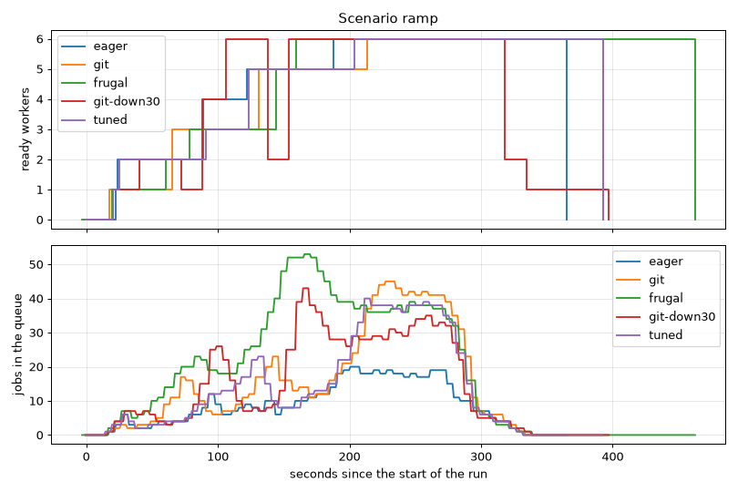

# Scenario `ramp`

Generated by `just bench-autoscaling ramp` (scripts/bench-report.py). Times from the start of the k6 run.

| | `eager` | `git` | `frugal` | `git-down30` | `tuned` |
| -- | -- | -- | -- | -- | -- |
| jobs per worker | 2 | 4 | 8 | 4 | 2 |
| zero workers after | 30 s | 60 s | 120 s | 60 s | 60 s |
| scale-down window | 300 s | 300 s | 300 s | 30 s | 120 s |
| jobs | 1079/1079 | 1080/1080 | 1080/1080 | 1080/1080 | 1080/1080 |
| first worker ready | 22 s | 17 s | 20 s | 20 s | 21 s |
| first job answered after | 14.5 s | 10.0 s | 15.1 s | 15.0 s | 17.7 s |
| 1 → max workers | 165 s (→ 6) | 196 s (→ 6) | 139 s (→ 6) | 86 s (→ 6) | 183 s (→ 6) |
| cold starts | 1 | 1 | 1 | 1 | 1 |
| latency median | 2.9 s | 5.4 s | 7.2 s | 5.3 s | 5.4 s |
| latency p95 | 5.5 s | 9.9 s | 12.9 s | 11.5 s | 9.2 s |
| latency max | 14.5 s | 13.7 s | 15.1 s | 15.2 s | 17.7 s |
| queue empty → zero workers | 34 s | 60 s | 124 s | 60 s | 62 s |
| worker-minutes | 27.7 | 28.9 | 36.2 | 24.7 | 29.7 |

