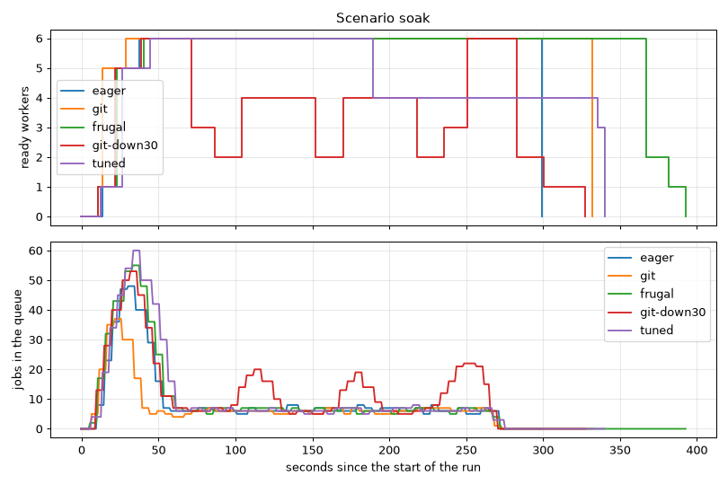

# Scenario `soak`

Generated by `just bench-autoscaling soak` (scripts/bench-report.py). Times from the start of the k6 run.

| | `eager` | `git` | `frugal` | `git-down30` | `tuned` |
| -- | -- | -- | -- | -- | -- |
| jobs per worker | 2 | 4 | 8 | 4 | 2 |
| zero workers after | 30 s | 60 s | 120 s | 60 s | 60 s |
| scale-down window | 300 s | 300 s | 300 s | 30 s | 120 s |
| jobs | 721/721 | 721/721 | 720/720 | 721/721 | 721/721 |
| first worker ready | 13 s | 10 s | 10 s | 11 s | 12 s |
| first job answered after | 15.3 s | 12.7 s | 12.2 s | 12.1 s | 15.4 s |
| 1 → max workers | 24 s (→ 6) | 18 s (→ 6) | 30 s (→ 6) | 28 s (→ 6) | 32 s (→ 6) |
| cold starts | 1 | 1 | 1 | 1 | 1 |
| latency median | 2.4 s | 2.4 s | 2.4 s | 4.0 s | 2.5 s |
| latency p95 | 14.1 s | 9.9 s | 18.5 s | 17.7 s | 17.3 s |
| latency max | 21.6 s | 14.7 s | 23.4 s | 22.6 s | 24.6 s |
| queue empty → zero workers | 28 s | 60 s | 121 s | 58 s | 66 s |
| worker-minutes | 27.7 | 31.7 | 35.1 | 18.9 | 26.3 |

