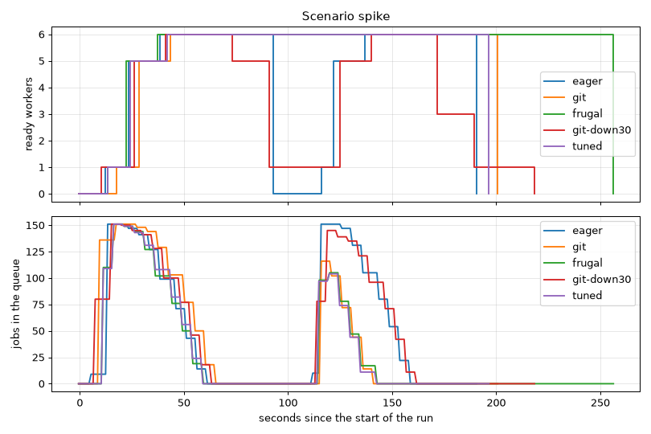

# Scenario `spike`

Generated by `just bench-autoscaling spike` (scripts/bench-report.py). Times from the start of the k6 run.

| | `eager` | `git` | `frugal` | `git-down30` | `tuned` |
| -- | -- | -- | -- | -- | -- |
| jobs per worker | 2 | 4 | 8 | 4 | 2 |
| zero workers after | 30 s | 60 s | 120 s | 60 s | 60 s |
| scale-down window | 300 s | 300 s | 300 s | 30 s | 120 s |
| jobs | 302/302 | 302/302 | 302/302 | 302/302 | 301/301 |
| first worker ready | 12 s | 18 s | 13 s | 10 s | 13 s |
| first job answered after | 15.4 s | 20.9 s | 14.9 s | 15.4 s | 15.3 s |
| 1 → max workers | 26 s (→ 6) | 26 s (→ 6) | 24 s (→ 6) | 31 s (→ 6) | 29 s (→ 6) |
| cold starts | 2 | 1 | 1 | 1 | 1 |
| latency median | 33.5 s | 24.0 s | 21.0 s | 35.1 s | 20.2 s |
| latency p95 | 46.2 s | 51.3 s | 45.4 s | 49.3 s | 46.5 s |
| latency max | 48.3 s | 53.9 s | 47.5 s | 51.5 s | 48.7 s |
| latency median, first burst | 35.2 s | 40.7 s | 34.3 s | 38.5 s | 35.2 s |
| latency median, second burst | 31.9 s | 14.6 s | 11.6 s | 32.2 s | 11.3 s |
| queue empty → zero workers | 33 s | 61 s | 114 s | 58 s | 55 s |
| worker-minutes | 13.6 | 17.2 | 23.3 | 12.7 | 17.3 |

